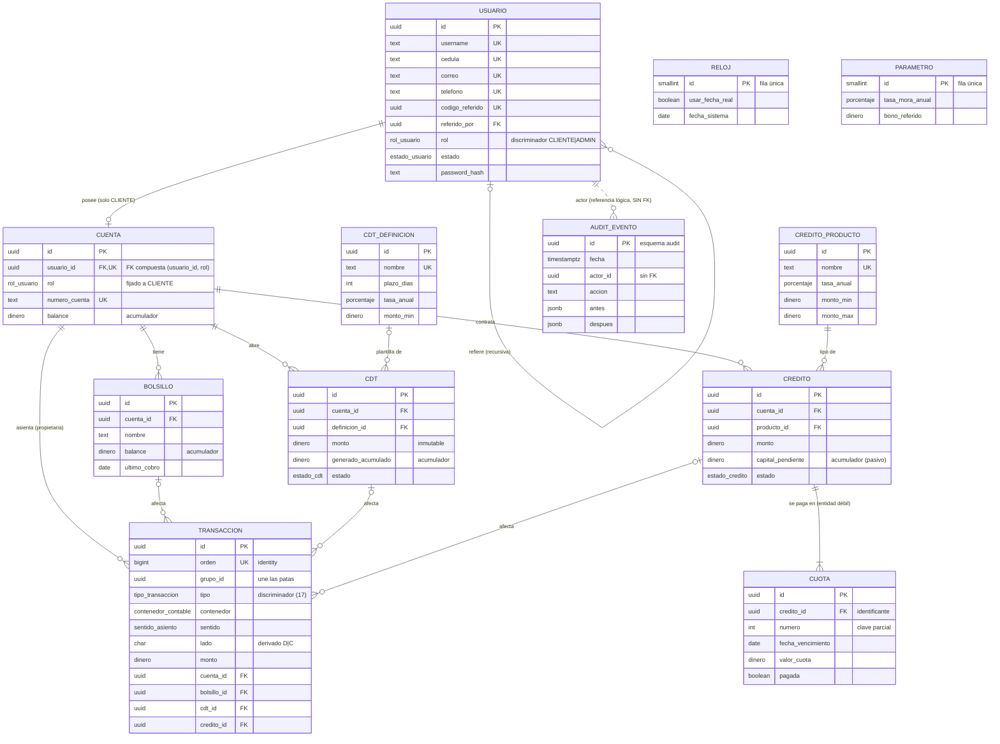
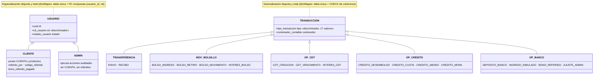

# Etapa 1 — Esquema y permisos · Entrega 1: diseño (para tu revisión)

> **Estado (actualizado tras la aprobación):** este diseño **ya está implementado** en `db/sql/01…05`; el resultado, las pruebas y la guía de verificación están en `docs/db/etapas/01-esquema.md`. Este documento refleja el diseño **tal como quedó implementado**: las correcciones pedidas en la revisión (M4, cardinalidad CLIENTE–CUENTA, permisos por columna de `banco_lector` y límites del libro mayor) ya están incorporadas. No hay funciones de negocio ni triggers del libro mayor (son de E2+). Nada de `front/` ni del backend. Sin commits.
> Base: diseño consolidado v3 (aprobado), D2 validada, D3/D5/D9a/D12a/D14–D17 aprobadas. Las decisiones financieras y de negocio del equipo (D1, D4, D6–D13) siguen **congeladas**: cuando una columna depende de una de ellas, se indica y **se difiere**.

## Índice
1. MERE definitivo · 2. Modelo relacional · 3. Diccionario de datos · 4. Relaciones y cardinalidades · 5. Especialización USUARIO y generalización TRANSACCIÓN · 6. Entidad débil CUOTA · 7. Esquemas `public` y `audit` · 8. Roles y permisos · 9. Qué se difiere y por qué · 10. Plan de scripts de E1 y pruebas · 11. Decisiones menores que necesito que confirmes

---

## 1. Diagrama MERE actualizado y definitivo

### 1.1 Entidades, atributos clave y relaciones
(Se muestran claves y atributos que dan sentido al dominio; **todas** las columnas están en el §3.)

**Notas de lectura**
- `USUARIO ||--o| CUENTA`: un usuario tiene **como máximo una** cuenta (el ADMIN nunca; el CLIENTE una). Desde `CUENTA`, el usuario es siempre uno (y de rol CLIENTE). **Distinción importante:** el esquema de E1 (UNIQUE + FK compuesta) garantiza *como máximo una* y *solo para CLIENTE*, pero **no** garantiza que todo CLIENTE *tenga* cuenta: la participación total del CLIENTE en CUENTA la garantiza `registrar_usuario` (E4), que crea el usuario y su cuenta en **una misma transacción**.
- `CUENTA ||--o{ TRANSACCION` es además la **relación recursiva M:N CUENTA–CUENTA "transfiere"**: cada envío entre cuentas se materializa como dos filas (`ENVIO` en la emisora, `RECIBO` en la receptora) unidas por `grupo_id`; `TRANSACCION` es la **entidad asociativa** con atributos (monto, nota, fecha).
- `AUDIT_EVENTO` está en el esquema `audit`; la línea punteada indica que **no hay FK** (la bitácora sobrevive al borrado del usuario).
- `RELOJ` y `PARAMETRO` son entidades singleton (una sola fila): configuración del banco, sin relaciones.
- En el diagrama aparecen **11 entidades en `public` + 1 en `audit`**, exactamente las 11 tablas del contrato.

### 1.2 Construcciones extendidas (especialización y generalización)

---

## 2. Modelo relacional completo

Convención de nombres de restricciones: `pk_<tabla>`, `uq_<tabla>_<cols>`, `fk_<tabla>_<destino>`, `ck_<tabla>_<regla>`, `ix_<tabla>_<cols>`.
Tipos/dominios compartidos (se crean antes que las tablas): dominios `dinero` y `porcentaje`; enumerados `rol_usuario`, `estado_usuario`, `estado_cdt`, `estado_credito`, `tipo_transaccion` (17), `contenedor_contable`, `sentido_asiento` (ver §3.0).

### 2.1 Tablas de `public`

**usuario**(`id` PK, `username` UQ, `password_hash`, `nombres`, `apellidos`, `cedula` UQ, `correo` UQ, `telefono` UQ, `fecha_nacimiento`, `rol`, `estado`, `correoverificado`, `codigo_referido` UQ, `referido_por` FK→usuario(id), `bono_referido_pagado`, `creado_en`)
- PK `pk_usuario(id)` · UQ `uq_usuario_username`, `uq_usuario_cedula`, `uq_usuario_correo`, `uq_usuario_telefono`, `uq_usuario_codigo_referido`, **`uq_usuario_id_rol (id, rol)`** (destino de la FK compuesta de `cuenta`).
- FK `fk_usuario_referidor (referido_por) → usuario(id) ON DELETE SET NULL`.
- CHECK: `ck_usuario_username` (minúsculas/dígitos, 3–30), `ck_usuario_correo_formato` (con `@` y punto) y `ck_usuario_correo_minusculas` (`correo = lower(correo)`, para que el UNIQUE sea insensible a mayúsculas), `ck_usuario_cedula_digitos`, `ck_usuario_telefono_digitos`, `ck_usuario_textos_no_vacios` (nombres/apellidos), `ck_usuario_nacimiento_rango` (≥ 1900-01-01), `ck_usuario_no_se_refiere_a_si_mismo` (`referido_por <> id`), **`ck_usuario_subtipo`** (`rol = 'CLIENTE' OR (referido_por IS NULL AND bono_referido_pagado = false)`).

**cuenta**(`id` PK, `usuario_id` UQ FK, `rol` FK, `numero_cuenta` UQ, `balance`, `creado_en`)
- PK `pk_cuenta(id)` · UQ `uq_cuenta_usuario (usuario_id)`, `uq_cuenta_numero (numero_cuenta)`.
- **FK compuesta** `fk_cuenta_usuario (usuario_id, rol) → usuario(id, rol) ON DELETE CASCADE`.
- CHECK `ck_cuenta_rol_cliente` (`rol = 'CLIENTE'`), `ck_cuenta_numero_formato` (`^[0-9]{10}$`), `ck_cuenta_balance_no_negativo` (`balance ≥ 0`).

**bolsillo**(`id` PK, `cuenta_id` FK, `nombre`, `balance`, `ultimo_cobro`, `creado_en`)
- PK `pk_bolsillo` · FK `fk_bolsillo_cuenta (cuenta_id) → cuenta(id) ON DELETE CASCADE`.
- **Sin UNIQUE sobre el nombre**: ni el spec (§5, §7.4 "varios, con nombre propio"), ni el contrato, ni el mock exigen nombres únicos; se permiten duplicados.
- CHECK `ck_bolsillo_nombre_no_vacio` (el mock rechaza el nombre vacío), `ck_bolsillo_balance_no_negativo`.

**cdt_definicion**(`id` PK, `nombre` UQ, `plazo_dias`, `tasa_anual`, `monto_min`)
- PK · UQ `uq_cdt_definicion_nombre` · CHECK `ck_cdt_definicion_plazo (plazo_dias > 0)`, `ck_cdt_definicion_monto_min (monto_min > 0)`; `tasa_anual` ya acotada por el dominio `porcentaje`.

**cdt**(`id` PK, `cuenta_id` FK, `definicion_id` FK, `nombre`, `monto`, `tasa_anual`, `plazo_dias`, `fecha_inicio`, `fecha_fin`, `generado_acumulado`, `ultimo_cobro`, `estado`)
- PK · FK `fk_cdt_cuenta → cuenta(id) ON DELETE CASCADE` · FK `fk_cdt_definicion (definicion_id) → cdt_definicion(id) ON DELETE SET NULL`.
- CHECK `ck_cdt_monto_positivo`, `ck_cdt_plazo_positivo`, `ck_cdt_generado_no_negativo`, **`ck_cdt_fechas_coherentes`** (`fecha_fin = fecha_inicio + plazo_dias`), `ck_cdt_ultimo_cobro` (`ultimo_cobro ≥ fecha_inicio`).

**credito_producto**(`id` PK, `nombre` UQ, `descripcion`, `tasa_anual`, `monto_min`, `monto_max`, `plazo_min_meses`, `plazo_max_meses`, `tope_absoluto`, `multiplicador_balance`, `aplica_regla_edad`)
- PK · UQ `uq_credito_producto_nombre` · CHECK `ck_credito_producto_montos` (`0 < monto_min ≤ monto_max`), `ck_credito_producto_plazos` (`1 ≤ plazo_min_meses ≤ plazo_max_meses`), `ck_credito_producto_tope` (`tope_absoluto IS NULL OR tope_absoluto > 0`), `ck_credito_producto_multiplicador` (`multiplicador_balance IS NULL OR multiplicador_balance > 0`).

**credito**(`id` PK, `cuenta_id` FK, `producto_id` FK, `monto`, `tasa_anual`, `plazo_meses`, `fecha_desembolso`, `capital_pendiente`, `descuento_automatico`, `mora_acumulada`, `fecha_interes`, `estado`)
- PK · FK `fk_credito_cuenta → cuenta(id) ON DELETE CASCADE` · FK `fk_credito_producto → credito_producto(id)` (NO ACTION: un producto con créditos no se borra).
- **Índice único parcial** `uq_credito_vivo_por_producto (cuenta_id, producto_id) WHERE estado = 'ACTIVO'` (la regla "un crédito vivo por producto" queda en el esquema).
- CHECK `ck_credito_monto_positivo`, `ck_credito_plazo_positivo`, `ck_credito_capital_rango` (`0 ≤ capital_pendiente ≤ monto`), `ck_credito_pagado_sin_deuda` (`estado <> 'PAGADO' OR capital_pendiente = 0`), `ck_credito_mora_no_negativa`.

**cuota** *(entidad débil de credito)*(`id` PK, `credito_id` FK, `numero`, `fecha_vencimiento`, `valor_cuota_original`, `valor_cuota`, `capital_programado`, `interes_programado`, `capital_pagado`, `intereses_pagados`, `fecha_pago`, `pagada`)
- PK `pk_cuota(id)` · **UQ `uq_cuota_credito_numero (credito_id, numero)`** (la clave real de la entidad débil) · FK `fk_cuota_credito → credito(id) ON DELETE CASCADE`.
- CHECK `ck_cuota_numero_positivo`, `ck_cuota_valores_positivos` (`valor_cuota_original > 0 AND valor_cuota > 0`), **`ck_cuota_desglose`** (`valor_cuota = capital_programado + interes_programado`, ambos ≥ 0), `ck_cuota_pagos_no_negativos`, **`ck_cuota_pagada_con_fecha`** (`pagada = (fecha_pago IS NOT NULL)`).

**transaccion** *(libro mayor)*(`id` PK, `orden` UQ identity, `grupo_id`, `fecha`, `tipo`, `contenedor`, `sentido`, `lado` generada, `monto`, `saldo_previo`, `saldo_posterior`, `nota`, `cuenta_id` FK, `bolsillo_id` FK, `cdt_id` FK, `credito_id` FK, `contraparte_nombre`, `contraparte_cuenta`)
- PK · UQ `uq_transaccion_orden` · FK `fk_transaccion_cuenta (cuenta_id) → cuenta(id) ON DELETE CASCADE`; FK `fk_transaccion_bolsillo`, `fk_transaccion_cdt`, `fk_transaccion_credito` → sus tablas con **NO ACTION** (el libro mayor no se queda huérfano si alguien borra un bolsillo/CDT/crédito suelto; el borrado de un usuario sigue funcionando porque la cascada elimina antes las filas del libro por `cuenta_id` en la misma sentencia — se prueba en E1).
- **Alcance de los CHECK de `transaccion` en E1:** validan la coherencia de **cada fila**. Que cada **grupo** de asientos cuadre (Σ Débitos = Σ Créditos por `grupo_id`) es del trigger diferido de la **Etapa 2**; en E1 una pata suelta se acepta (y hay una prueba que lo documenta).
- `lado` = columna **generada** (`GENERATED ALWAYS AS … STORED`): `D` si (`CUENTA|BOLSILLO|CDT`, `E`) o (`CREDITO|RESULTADO`, `S`); `C` en los otros casos.
- CHECK: `ck_transaccion_monto_positivo`; **`ck_transaccion_tipo_contenedor_sentido`** (la matriz contable de D2: lista cerrada de 37 combinaciones permitidas `(tipo, contenedor, sentido)`); tres CHECK de familia, `ck_transaccion_cdt_id_familia`, `ck_transaccion_credito_id_familia` y `ck_transaccion_bolsillo_id_familia` (cada id de producto solo aparece en tipos de su familia y es obligatorio en ella: `CDT_*`/`INTERES_CDT ⇒ cdt_id`, `CREDITO_* ⇒ credito_id`, `BOLSO_*`/`INTERES_BOLSO ⇒ bolsillo_id`, y un `ENVIO` lleva `bolsillo_id` si y solo si sale de un bolsillo). *(El CHECK "por contenedor" del borrador resultó redundante con la matriz más estos tres y se eliminó.)* `ck_transaccion_saldos` (contenedores almacenados `CUENTA/BOLSILLO/CREDITO` llevan `saldo_previo` y `saldo_posterior` con `posterior = previo ± monto` según `sentido`; los derivados `CDT/RESULTADO` los llevan NULL).

**reloj**(`id` PK, `usar_fecha_real`, `fecha_sistema`) — fila única.
- PK `pk_reloj` + `ck_reloj_fila_unica (id = 1)` · `ck_reloj_fecha_si_manual` (`usar_fecha_real OR fecha_sistema IS NOT NULL`).

**parametro**(`id` PK, `tasa_mora_anual`, `tasa_bolsillo_anual`, `bono_referido`, `edad_limite_inmuebles`, `ingresos_simulados_cantidad`, `ingreso_simulado_min`, `ingreso_simulado_max`, `monto_maximo`) — fila única.
- PK + `ck_parametro_fila_unica (id = 1)` · `ck_parametro_rango_simulado` (`0 < min ≤ max`) · `ck_parametro_valores_positivos`.

### 2.2 Esquema `audit`
**audit.evento**(`id` PK, `orden` UQ identity, `fecha`, `actor_id`, `actor_username`, `accion`, `entidad`, `entidad_id`, `antes`, `despues`) — **sin ninguna FK**; CHECK `ck_evento_accion_no_vacia`.

### 2.3 Índices (no únicos) previstos en E1
Los índices de FK que PostgreSQL **no** crea solos y los de acceso frecuente (todos `IF NOT EXISTS`):

| Índice | Para qué |
|---|---|
| `ix_transaccion_cuenta_orden (cuenta_id, orden DESC)` | historial y "últimas 8" de un cliente |
| `ix_transaccion_grupo (grupo_id)` | recomponer las patas de una operación |
| `ix_transaccion_bolsillo`, `_cdt`, `_credito` (parciales `WHERE … IS NOT NULL`) | patas por producto; soporte de las FK |
| `ix_bolsillo_cuenta (cuenta_id)` | bolsillos de una cuenta |
| `ix_cdt_cuenta_estado (cuenta_id, estado)`, `ix_cdt_definicion (definicion_id) WHERE definicion_id IS NOT NULL` | CDT vigentes e historial (no parcial: también sirve al borrado en cascada de CDT CERRADOS); FK |
| `ix_credito_cuenta_estado (cuenta_id, estado)`, `ix_credito_producto (producto_id)` | créditos vigentes e historial (no parcial, por la misma razón); FK |
| `ix_cuota_pendiente (credito_id, numero) WHERE NOT pagada` | próxima cuota por pagar y mora |
| `ix_usuario_referidor (referido_por) WHERE referido_por IS NOT NULL` | referidos de un usuario; FK |

Los índices GIN `pg_trgm`/`unaccent` de la búsqueda admin **se difieren a E11** (necesitan una función envoltorio inmutable de `unaccent`, y esa búsqueda es una función de negocio). `audit.evento`: `ix_evento_fecha (fecha DESC)`, `ix_evento_entidad (entidad, entidad_id)`.

---

## 3. Diccionario de datos

Convenciones: todo `id` es `uuid DEFAULT gen_random_uuid()`. "Nulo" = admite NULL. Las fechas de negocio las fijará el reloj del banco (`hoy_banco()`, E3); los `DEFAULT now()` marcados "técnico" solo son marcas de creación.

### 3.0 Tipos compartidos
| Tipo | Definición | Propósito |
|---|---|---|
| `dinero` | `NUMERIC(18,2)` con `CHECK (VALUE > -1e13 AND VALUE < 1e13)` | Importes COP. El tope < 10¹³ garantiza el transporte sin pérdida de centavos a Node.js (D.8). El signo lo dan `sentido`/`lado`, no el valor |
| `porcentaje` | `NUMERIC(6,3)` con `CHECK (VALUE > 0 AND VALUE <= 100)` | Tasas como porcentaje (12 = 12 %), formato del contrato |
| `rol_usuario` | `CLIENTE`, `ADMIN` | Discriminador de la especialización |
| `estado_usuario` | `ACTIVO`, `BLOQUEADO` | Estado de acceso |
| `estado_cdt` | `ACTIVO`, `CERRADO` | Ciclo de vida del CDT |
| `estado_credito` | `ACTIVO`, `PAGADO` | Ciclo de vida del crédito |
| `tipo_transaccion` | los 17 tipos del contrato | Discriminador de la generalización |
| `contenedor_contable` | `CUENTA`, `BOLSILLO`, `CDT`, `CREDITO`, `RESULTADO` | Qué acumulador afecta una pata (D2) |
| `sentido_asiento` | `E` (aumenta), `S` (disminuye) | Dirección sobre el acumulador del contenedor |

### 3.1 usuario
| Columna | Tipo | Nulo / Default | Propósito |
|---|---|---|---|
| id | uuid | NO / gen | Identidad opaca (sin ids secuenciales en URLs) |
| username | text | NO | Llave de login (autogenerado por `registrar_usuario`, E4) |
| password_hash | text | NO | Hash bcrypt hecho en el backend; la BD nunca ve la clave en claro |
| nombres, apellidos | text | NO | Nombre legal; el contrato muestra `nombres \|\| ' ' \|\| apellidos` |
| cedula | text | NO | Documento de identidad (único) |
| correo | text | NO | Correo en minúsculas (único) |
| telefono | text | NO | Teléfono (único) |
| fecha_nacimiento | date | NO | Para la regla de edad de Inmuebles |
| rol | rol_usuario | NO / `CLIENTE` | Discriminador CLIENTE/ADMIN |
| estado | estado_usuario | NO / `ACTIVO` | Bloqueo de acceso (mensaje del contrato al bloquear) |
| correoverificado | boolean | NO / false | Verificación de correo (dispara el bono de referido). *Se conserva el nombre del spec §5* |
| codigo_referido | uuid | NO / gen | Código público que el usuario comparte (`?ref=`) |
| referido_por | uuid | **SÍ** | Quién lo refirió (auto-FK; solo CLIENTE) |
| bono_referido_pagado | boolean | NO / false | Idempotencia del bono de $50.000 |
| creado_en | timestamptz | NO / now() *(técnico)* | Alta |

### 3.2 cuenta
| Columna | Tipo | Nulo / Default | Propósito |
|---|---|---|---|
| id | uuid | NO / gen | Propietaria de bolsillos, productos y asientos |
| usuario_id | uuid | NO, único | Dueño (un cliente, una cuenta) |
| rol | rol_usuario | NO / `CLIENTE` | Columna de subtipo: junto a `usuario_id` forma la FK compuesta; el CHECK impide cuentas de ADMIN |
| numero_cuenta | text | NO | 10 dígitos únicos, visibles al usuario; destino de transferencias |
| balance | dinero | NO / 0 | **Acumulador** del principal (≥ 0). Solo lo mueve el libro mayor (E2) |
| creado_en | timestamptz | NO / now() *(técnico)* | Alta |

### 3.3 bolsillo
| Columna | Tipo | Nulo / Default | Propósito |
|---|---|---|---|
| id, cuenta_id | uuid | NO | Identidad y propietaria |
| nombre | text | NO | Nombre dado por el usuario ("Viajes") |
| balance | dinero | NO / 0 | **Acumulador** del bolsillo (≥ 0) |
| ultimo_cobro | date | NO *(sin default)* | Hasta qué día se le ha cobrado interés (cobro lazy); lo fija la función al crear |
| creado_en | timestamptz | NO / now() *(técnico)* | Alta |

### 3.4 cdt_definicion
| Columna | Tipo | Nulo / Default | Propósito |
|---|---|---|---|
| id | uuid | NO | Plantilla ofertada |
| nombre | text | NO, único | Nombre mostrado ("CDT 6 meses") |
| plazo_dias | integer | NO | Plazo en días (> 0) |
| tasa_anual | porcentaje | NO | Tasa editable por el admin; se **copia** al crear cada CDT |
| monto_min | dinero | NO | Mínimo para abrir (contrato §4); > 0 |

### 3.5 cdt
| Columna | Tipo | Nulo / Default | Propósito |
|---|---|---|---|
| id, cuenta_id | uuid | NO | Identidad y propietaria |
| definicion_id | uuid | **SÍ** | Plantilla de origen (si se borra la plantilla queda NULL; el CDT conserva sus copias) |
| nombre | text | NO | Copia del nombre de la plantilla |
| monto | dinero | NO | Principal bloqueado (**inmutable**, > 0) |
| tasa_anual | porcentaje | NO | Tasa copiada al crear |
| plazo_dias | integer | NO | Plazo copiado al crear |
| fecha_inicio, fecha_fin | date | NO | Vigencia; `fecha_fin = fecha_inicio + plazo_dias` |
| generado_acumulado | dinero | NO / 0 | **Acumulador** = Σ asientos `INTERES_CDT` (no decrece) |
| ultimo_cobro | date | NO *(sin default)* | Hasta qué día se ha devengado (cobro lazy) |
| estado | estado_cdt | NO / `ACTIVO` | ACTIVO → CERRADO (historial) |

### 3.6 credito_producto
| Columna | Tipo | Nulo / Default | Propósito |
|---|---|---|---|
| id | uuid | NO | Producto ofertado |
| nombre | text | NO, único | "Libre inversión", "Vehículo", … (nombres finales: D11, equipo) |
| descripcion | text | NO / `''` | Texto para la landing |
| tasa_anual | porcentaje | NO | Editable por el admin; se copia al crear cada crédito |
| monto_min, monto_max | dinero | NO | Rango base del producto |
| plazo_min_meses | integer | NO / 1 | Contrato §4 ("Plazo X a Y meses") |
| plazo_max_meses | integer | NO | Plazo máximo base |
| tope_absoluto | dinero | **SÍ** | Tope fijo ($30M libre inversión; $2.000M inmuebles) |
| multiplicador_balance | numeric(8,2) | **SÍ** | Veces el balance total (100 en Inmuebles) |
| aplica_regla_edad | boolean | NO / false | Si aplica `edad + años ≤ límite` |

### 3.7 credito
| Columna | Tipo | Nulo / Default | Propósito |
|---|---|---|---|
| id, cuenta_id | uuid | NO | Identidad y propietaria |
| producto_id | uuid | NO | Producto (no se puede borrar si tiene créditos) |
| monto | dinero | NO | Principal desembolsado |
| tasa_anual | porcentaje | NO | Tasa copiada al crear |
| plazo_meses | integer | NO | Plazo pactado |
| fecha_desembolso | date | NO | Fecha del desembolso (reloj del banco) |
| capital_pendiente | dinero | NO | **Acumulador (pasivo)**; 0 ≤ valor ≤ monto |
| descuento_automatico | boolean | NO / false | Si el cobro lazy debita las cuotas |
| mora_acumulada | dinero | NO / 0 | Columna del spec §5; **su uso/definición queda sujeto a D7** |
| fecha_interes | date | NO *(sin default)* | Corte hasta el que se ha devengado interés (spec §8) |
| estado | estado_credito | NO / `ACTIVO` | ACTIVO → PAGADO |

### 3.8 cuota
| Columna | Tipo | Nulo / Default | Propósito |
|---|---|---|---|
| id | uuid | NO | Identidad sustituta (todo con UUID) |
| credito_id | uuid | NO | Crédito del que depende (identificante) |
| numero | integer | NO | Clave parcial: nº de cuota dentro del crédito (≥ 1) |
| fecha_vencimiento | date | NO | Cuándo vence (se necesita para mora y cobro automático) |
| valor_cuota_original | dinero | NO | Valor del plan original (spec §5) |
| valor_cuota | dinero | NO | Valor vigente (cambia al recalcular tras un abono) |
| capital_programado, interes_programado | dinero | NO | Desglose del plan vigente; suman `valor_cuota` |
| capital_pagado, intereses_pagados | dinero | NO / 0 | Lo realmente pagado (spec §5) |
| fecha_pago | date | **SÍ** | Cuándo se pagó; NULL si no |
| pagada | boolean | NO / false | Coherente con `fecha_pago` |

### 3.9 transaccion
| Columna | Tipo | Nulo / Default | Propósito |
|---|---|---|---|
| id | uuid | NO | Identidad de la pata |
| orden | bigint | NO / identity | Orden real de inserción (el historial se ordena por esto, no por fecha) |
| grupo_id | uuid | NO | Une las patas de **una** operación (cuadre D2) |
| fecha | timestamptz | NO | Fecha/hora de negocio (reloj del banco) |
| tipo | tipo_transaccion | NO | Operación (17 tipos del contrato) |
| contenedor | contenedor_contable | NO | Qué acumulador afecta la pata |
| sentido | sentido_asiento | NO | `E` aumenta / `S` disminuye el acumulador |
| lado | char(1) | NO, **generada** | `D`/`C` derivado de `contenedor` y `sentido`; base del cuadre Σ D = Σ C |
| monto | dinero | NO | Importe positivo de la pata |
| saldo_previo, saldo_posterior | dinero | **SÍ** | Saldo del contenedor antes/después (solo contenedores almacenados) |
| nota | text | **SÍ** | Nota del usuario/admin |
| cuenta_id | uuid | NO | Cuenta propietaria de la pata (para la cascada y la propiedad) |
| bolsillo_id, cdt_id, credito_id | uuid | **SÍ** | Producto afectado/referenciado según el tipo |
| contraparte_nombre, contraparte_cuenta | text | **SÍ** | *Snapshot* de la contraparte (otro cliente o "Banco Digital"); sin FK |

### 3.10 reloj
| Columna | Tipo | Nulo / Default | Propósito |
|---|---|---|---|
| id | smallint | NO / 1 | Fila única |
| usar_fecha_real | boolean | NO / true | Modo del reloj del banco |
| fecha_sistema | date | **SÍ** | Fecha manual (obligatoria si el modo es manual) |

### 3.11 parametro
| Columna | Tipo | Nulo / Default | Propósito |
|---|---|---|---|
| id | smallint | NO / 1 | Fila única |
| tasa_mora_anual | porcentaje | **SÍ** | Mora global editable por el admin. **Sin valor inicial** hasta que el equipo decida (D7/D11): no se inventa una tasa |
| tasa_bolsillo_anual | porcentaje | NO / 12 | 12 % del spec §7.4 |
| bono_referido | dinero | NO / 50000 | $50.000 del spec §7.1 |
| edad_limite_inmuebles | smallint | NO / 70 | Límite de la regla `edad + años ≤ 70` (spec §7.6) |
| ingresos_simulados_cantidad | smallint | NO / 5 | Cuántos `INGRESO_SIMULADO` al registrar (spec §7.1) |
| ingreso_simulado_min, ingreso_simulado_max | dinero | NO / 10000, 1000000 | Rango de esos ingresos (spec §7.1) |
| monto_maximo | dinero | NO / 9999999999999.99 | Tope técnico de cualquier importe (transporte sin pérdida, D.8) |

### 3.12 audit.evento
| Columna | Tipo | Nulo / Default | Propósito |
|---|---|---|---|
| id | uuid | NO / gen | Identidad del evento |
| orden | bigint | NO / identity | Orden de ocurrencia |
| fecha | timestamptz | NO / now() *(técnico)* | Momento del hecho |
| actor_id | uuid | **SÍ** | Quién actuó (**sin FK**; NULL si fue el sistema) |
| actor_username | text | **SÍ** | *Snapshot* del username (sobrevive al borrado del usuario) |
| accion | text | NO | Qué pasó (`USUARIO_BLOQUEADO`, `TASA_CDT_MODIFICADA`, …) |
| entidad, entidad_id | text | **SÍ** | Sobre qué (tabla e id como texto; el id puede ser smallint en los singleton) |
| antes, despues | jsonb | **SÍ** | Estado previo y posterior |

---

## 4. Justificación de relaciones y cardinalidades

| Relación | Cardinalidad | Implementación | Por qué |
|---|---|---|---|
| USUARIO posee CUENTA | 1 : 0..1 en el esquema (ADMIN: 0; CLIENTE: ≤ 1). La existencia de la cuenta del CLIENTE la garantiza `registrar_usuario` (E4), no el esquema | `cuenta.usuario_id` UNIQUE + FK compuesta `(usuario_id, rol)` `CASCADE` | El spec da una cuenta por cliente; separar `cuenta` de `usuario` deja el dinero aislado de la identidad y permite que solo el CLIENTE tenga cuenta (subtipo). `CASCADE`: borrar al usuario borra su cuenta y productos (spec §15.5) |
| USUARIO refiere USUARIO | 0..1 : 0..N (recursiva) | `usuario.referido_por` FK `SET NULL` | Sistema de referidos; si el referidor se borra, el referido sigue existiendo (no cascada) |
| CUENTA tiene BOLSILLO | 1 : 0..N | `bolsillo.cuenta_id` `CASCADE` | Un cliente puede crear varios bolsillos; dependen de la cuenta |
| CUENTA abre CDT | 1 : 0..N | `cdt.cuenta_id` `CASCADE` | Varios CDT simultáneos e históricos (CERRADO) |
| CDT_DEFINICION → CDT | 0..1 : 0..N | `cdt.definicion_id` `SET NULL` | La plantilla es editable (tasa) y los CDT guardan **copias**; la FK es solo trazabilidad, por eso no bloquea el borrado de la plantilla |
| CUENTA contrata CRÉDITO | 1 : 0..N | `credito.cuenta_id` `CASCADE` + índice único parcial (un ACTIVO por producto) | Varios créditos a la vez, pero no dos vivos del mismo producto |
| CREDITO_PRODUCTO → CRÉDITO | 1 : 0..N | `credito.producto_id` NO ACTION | Un producto con créditos no se elimina; lo no copiado (tasa, plazo, monto) ya vive en el crédito |
| CRÉDITO se paga en CUOTA | 1 : 1..N (identificante) | `cuota.credito_id` `CASCADE`, UNIQUE `(credito_id, numero)` | Entidad débil (§6) |
| CUENTA asienta TRANSACCIÓN | 1 : 0..N | `transaccion.cuenta_id` `CASCADE` | Toda pata pertenece a una cuenta; al borrar al usuario se borra su libro (las contrapartes de terceros conservan su propia pata, con la contraparte como texto) |
| BOLSILLO / CDT / CRÉDITO afectan TRANSACCIÓN | 0..1 : 0..N | FK NO ACTION | Trazabilidad del producto; NO ACTION protege el libro de borrados sueltos |
| CUENTA–CUENTA "transfiere" | M : N | entidad asociativa TRANSACCIÓN (dos patas `ENVIO`/`RECIBO` unidas por `grupo_id`) | Es una relación con atributos (monto, nota, fecha), recursiva sobre CUENTA |
| USUARIO ··· AUDIT_EVENTO | 1 : 0..N lógica | **sin FK**, snapshot | La bitácora debe sobrevivir al borrado del usuario |

**Normalización:** 1FN (sin multivaluados, tipos como ENUM), 2FN (PK simple en todas), 3FN (sin dependencias transitivas; la *familia* de la transacción es derivable de `tipo` y por eso **no** se almacena). Las desnormalizaciones deliberadas son los acumuladores, `saldo_previo/posterior`, `lado` (generada) y las copias de tasa/plazo/monto/contraparte, todas justificadas en el diseño v3 y verificables con la conciliación de E2/E13.

---

## 5. Especialización USUARIO → CLIENTE/ADMIN y generalización TRANSACCIÓN

### 5.1 Especialización USUARIO → {CLIENTE, ADMIN}
- **Tipo:** disjunta (un usuario es CLIENTE o ADMIN, nunca ambos) y total (no hay usuarios de otro tipo). Se garantiza con `rol rol_usuario NOT NULL`, un enumerado cerrado.
- **Por qué es una especialización real y no solo un atributo:** las subclases difieren en **relaciones y comportamiento**, no solo en un flag. El CLIENTE *posee* una CUENTA (y por ella bolsillos, CDT, créditos y libro mayor) y participa en el sistema de referidos. El ADMIN *ejecuta* acciones auditadas (`audit.evento`) y **no tiene cuenta**. Los atributos exclusivos del CLIENTE (`referido_por`, `bono_referido_pagado`) se limitan con `ck_usuario_subtipo`.
- **Mapeo elegido: tabla única con discriminador.** Las dos subclases comparten casi todos los atributos (identidad, credenciales, estado); separarlas en tres tablas obligaría a JOIN para el login y duplicaría las UNIQUE. Para no perder la integridad del subtipo se usa el patrón estándar de **FK compuesta**: `cuenta(usuario_id, rol) → usuario(id, rol)` con `rol` de `cuenta` fijado a `CLIENTE` por CHECK. Resultado: **es imposible crear una cuenta para un ADMIN** y **no se puede cambiar el rol de un cliente con cuenta** (la actualización de `usuario.rol` violaría la FK).
- **Honestidad académica:** si el equipo quisiera que el ADMIN tuviera cuenta, la especialización colapsaría a un simple atributo `rol` y se dejaría de presentar como especialización.

### 5.2 Generalización TRANSACCIÓN en 5 familias
- **Tipo:** disjunta y total. El discriminador es `tipo` (17 valores del contrato); **la familia se deriva de `tipo`** y no se almacena (almacenarla sería una dependencia transitiva).

| Familia (subclase) | Tipos | Atributos/relaciones propios |
|---|---|---|
| Transferencia | `ENVIO`, `RECIBO` | contraparte (otro cliente) |
| Movimiento de bolsillo | `BOLSO_INGRESO`, `BOLSO_RETIRO`, `BOLSO_MOVIMIENTO`, `INTERES_BOLSO` | `bolsillo_id` |
| Operación de CDT | `CDT_CREACION`, `CDT_VENCIMIENTO`, `INTERES_CDT` | `cdt_id` |
| Operación de crédito | `CREDITO_DESEMBOLSO`, `CREDITO_CUOTA`, `CREDITO_ABONO`, `CREDITO_MORA` | `credito_id` |
| Operación del banco | `DEPOSITO_BANCO`, `INGRESO_SIMULADO`, `BONO_REFERIDO`, `AJUSTE_ADMIN` | contraparte "Banco Digital" |

  (2 + 4 + 3 + 4 + 4 = **17**.)
- **Mapeo elegido: tabla única + CHECK de coherencia.** Una sola tabla es el **libro mayor**: el historial de un cliente se lee con un solo índice, sin `UNION`, y la conciliación contable es una única consulta. La integridad entre subclase y columnas se impone con `ck_transaccion_ids_por_familia` (cada FK opcional solo aparece en su familia) y con `ck_transaccion_tipo_contenedor_sentido`, que codifica la **matriz contable validada en D2** (qué patas, en qué contenedor y con qué sentido admite cada tipo).
- **Contenedor y lado:** además de la generalización por `tipo`, cada pata declara el `contenedor` que afecta (CUENTA, BOLSILLO, CDT, CREDITO, RESULTADO) y su `lado` D/C derivado, de modo que el cuadre `Σ D = Σ C` por `grupo_id` es verificable con SQL. `RESULTADO` representa ingresos/gastos/patrimonio **del cliente**, no una cuenta contable real del banco. *El trigger que aplica los saldos y el chequeo de cuadre son de la Etapa 2; en E1 solo existe la estructura y los CHECK.*

---

## 6. Justificación de la entidad débil CUOTA

- **Dependencia de existencia:** una cuota no tiene sentido sin su crédito; al borrar el crédito (o el usuario) desaparecen (`ON DELETE CASCADE`).
- **Clave parcial:** `numero` solo identifica la cuota *dentro* de un crédito; la identificación completa es `(credito_id, numero)`, garantizada por `uq_cuota_credito_numero`. Se añade un `id uuid` sustituto solo por la convención del proyecto (todo con UUID); la clave real sigue siendo la compuesta.
- **Relación identificante** con participación total de CUOTA (toda cuota tiene crédito: `credito_id NOT NULL`). La cardinalidad **mínima** del lado crédito (1..N: "todo crédito vigente tiene al menos una cuota") **no se puede declarar con restricciones** en SQL estándar; la garantiza `solicitar_credito` (E8) generando el plan completo en la misma transacción. Se documenta así, sin ocultarlo.
- **Por qué es entidad y no atributo multivaluado del crédito:** cada cuota tiene atributos propios y cambiantes (vencimiento, valor, desglose capital/interés, pagos, fecha de pago, estado), se consulta y ordena por separado (próxima cuota, mora) y su número es variable (hasta 360).
- **Integridad propia:** `ck_cuota_desglose` (valor = capital + interés), `ck_cuota_pagada_con_fecha` y el índice parcial de cuotas pendientes.

---

## 7. Organización de los esquemas `public` y `audit`

| Esquema | Contenido en E1 | Propietario | Quién accede |
|---|---|---|---|
| **`public`** | 11 tablas del negocio · tipos/dominios (`dinero`, `porcentaje`, enumerados) · extensiones `unaccent`, `pg_trgm` · (en etapas siguientes) funciones `SECURITY DEFINER`, triggers y vistas `v_*` | `banco_owner` (las extensiones, `postgres`) | `banco_app`: solo `USAGE` (más `EXECUTE`/vistas cuando existan) · `banco_lector`: `SELECT` · `banco_dev`: ambos |
| **`audit`** | `evento` (única tabla) | `banco_owner` | `banco_app`: **nada** (ni `USAGE`) · `banco_lector`: `USAGE` + `SELECT` · escritura solo por funciones/triggers `SECURITY DEFINER` (etapas posteriores) |
| `tests` | helpers de prueba — **solo en `banco_test`**, nunca en `banco` | — | — |

Razones: (1) **el visor Control** (`admin_esquema`/`admin_tabla`, E12) consulta solo `public` y por tanto muestra exactamente las 11 tablas del contrato, sin excepciones; (2) la auditoría queda **fuera del alcance del backend** y de cualquier SQL de negocio; (3) separar por esquema permite otorgar permisos con un solo `GRANT USAGE`; (4) `public` deja de ser un "cajón": `REVOKE CREATE ON SCHEMA public FROM PUBLIC` y funciones no ejecutables por defecto.

---

## 8. Diseño de roles y permisos

### 8.1 Roles
| Rol | LOGIN | Para qué | Notas |
|---|---|---|---|
| `postgres` (superusuario del contenedor) | sí | **Solo aplicar DDL** (scripts de `db/sql`) | Conexión "administración" de pgAdmin. No se usa para el día a día |
| `banco_owner` | **no** | Dueño de todos los objetos del banco | Nadie inicia sesión con él; los scripts crean los objetos con `SET ROLE banco_owner` |
| `banco_ledger` | **no** | Único autorizado a modificar los acumuladores (E2) | Dueño solo de la función del trigger del libro mayor; en E1 solo recibe los permisos por columna |
| `banco_app` | sí | El backend: solo ejecuta funciones y lee vistas | `statement_timeout=5s`, `lock_timeout=3s`, `idle_in_transaction_session_timeout=15s` |
| `banco_lector` | sí | Inspección en solo lectura (pgAdmin/profesor) | `default_transaction_read_only=on`, `statement_timeout=15s`; **sin acceso a `password_hash`** |
| `banco_dev` | sí | Explorar y **probar funciones** desde el Query Tool sin ser superusuario | Miembro de `banco_lector` y `banco_app`; `statement_timeout=30s` |

Los roles son del **clúster**; `reset`/`banco_test` no los eliminan (los scripts son idempotentes: crean si faltan y reaplican `ALTER ROLE`/`GRANT`). Las contraseñas de los roles con login son **de desarrollo local, no secretas** (ver §11).

### 8.2 Permisos
| Objeto | `banco_owner` | `banco_ledger` | `banco_app` | `banco_lector` | `banco_dev` |
|---|---|---|---|---|---|
| `CONNECT` a `banco` | — | — | ✔ | ✔ | ✔ |
| Esquema `public` | dueño | `USAGE` | `USAGE` | `USAGE` | `USAGE` |
| Esquema `audit` | dueño | — | **✘** | `USAGE` | `USAGE` (vía lector) |
| Tablas `public` (DML) | todo | — | **✘ ninguno** | — | **✘ ninguno** |
| `SELECT` tablas `public` | ✔ | `cuenta`, `bolsillo`, `cdt`, `credito` | **✘** | ✔ las otras 10 tablas completas; **`usuario` solo por columna (15 de 16, sin `password_hash`) y SIN `SELECT` de tabla** | ✔ (vía lector) |
| `UPDATE` por columna | — | `cuenta(balance)`, `bolsillo(balance)`, `cdt(generado_acumulado)`, `credito(capital_pendiente)` | **✘** | **✘** | **✘** |
| `SELECT audit.evento` | ✔ | — | **✘** | ✔ | ✔ (vía lector) |
| Funciones (`EXECUTE`) | dueño | — | solo las públicas, **otorgadas una a una** (E3+) | — | ✔ (vía `banco_app`) |
| Vistas `v_*` | dueño | — | `SELECT` (E10) | `SELECT` | ✔ |
| Crear objetos / TRUNCATE | ✔ | — | **✘** | **✘** | **✘** |

### 8.3 Reglas de endurecimiento incluidas en E1
- `REVOKE ALL ON DATABASE banco FROM PUBLIC` y `GRANT CONNECT` solo a los roles con login; `REVOKE TEMPORARY` a PUBLIC.
- `REVOKE ALL ON SCHEMA public FROM PUBLIC` (y `CREATE` solo a `banco_owner`).
- `ALTER DEFAULT PRIVILEGES FOR ROLE banco_owner REVOKE EXECUTE ON FUNCTIONS FROM PUBLIC` (por defecto PostgreSQL deja **toda** función ejecutable por todos).
- Ningún rol de uso diario es superusuario ni dueño de objetos.
- Quién acuña dinero queda fuera del alcance de los roles: solo las funciones del banco, vía el libro mayor (E2).
- *Fuera de E1:* el trigger de guardia (`current_user = 'banco_ledger' AND pg_trigger_depth() > 1`), el trigger de inmutabilidad y el event trigger de DDL son de la Etapa 2.

---

## 9. Qué se difiere y por qué (no se decide nada congelado)

| Elemento | Depende de | Tratamiento en E1 |
|---|---|---|
| `reloj.desfase_dias` | D4 (equipo) | **No se crea.** `reloj` queda como el spec (3 columnas); si se aprueba la opción C se añade con `ALTER … ADD COLUMN IF NOT EXISTS` en E3 |
| `cuota.mora` / uso de `credito.mora_acumulada` | D7 | `credito.mora_acumulada` existe (spec §5) sin comportamiento; **no** se crea mora en `cuota` |
| `parametro.tasa_mora_anual` valor inicial | D1/D7/D11 | Columna **nullable**, sin valor |
| Seed de `cdt_definicion` y `credito_producto` (4 productos, tasas, límites, nombres) | D11 | **No se insertan.** Los CHECK están, las filas llegan en E7/E8 cuando el equipo apruebe el catálogo |
| Edad mínima de registro | D12b | Sin CHECK de edad mínima |
| Mensajes de error de violaciones (duplicados, etc.) | D13 | En E1 solo existen las restricciones; su traducción a `P0001` con mensaje es de E4+ |
| Índices GIN de búsqueda | E11 | Diferidos (necesitan funciones) |
| Trigger del libro mayor, cuadre diferido, guardias, inmutabilidad, `v_integridad_saldos` | E2 | No se tocan |
| Funciones de negocio, `hoy_banco()` | E3+ | No se tocan |

Filas que **sí** inserta E1 por ser estructura y no negocio: la fila única de `reloj` (`usar_fecha_real = true`) y la de `parametro` (con los valores del spec §7 listados en §3.11).

---

## 10. Plan de scripts y pruebas de E1 (a ejecutar **cuando apruebes este diseño**)

| Archivo | Contenido |
|---|---|
| `db/sql/01_roles.sql` | Roles, `ALTER ROLE … SET`, `CONNECT`, privilegios por defecto (idempotente) |
| `db/sql/02_tipos_dominios.sql` | Dominios `dinero`/`porcentaje` y enumerados (`DO` con comprobación de existencia) |
| `db/sql/03_schema.sql` | Esquema `audit` y las 11 tablas + `audit.evento` con todas sus restricciones, `COMMENT ON` de cada tabla y columna, filas únicas de `reloj`/`parametro` |
| `db/sql/04_indices.sql` | Índices de §2.3 (`IF NOT EXISTS`) |
| `db/sql/05_permisos.sql` | `GRANT`/`REVOKE` de §8 (incluidos los permisos por columna) |
| `db/tests/02_roles` · `03_schema` · `04_restricciones` · `05_libro_mayor` · `06_borrados` · `07_indices` · `08_permisos` · `09_idempotencia` `.test.sql` | Pruebas (abajo; el detalle y los resultados están en `01-esquema.md`) |
| `db/docker/pgadmin/servers.json` + comando `ctl pgadmin-servers` | Registra `banco_dev`, `banco_app`, `banco_lector` en pgAdmin sin recrear el volumen |
| `docs/db/etapas/01-esquema.md`, `docs/db/evidencias/01-esquema.txt` | Paquete final, evidencias y guía "verifícalo en pgAdmin" |

Todos los `.sql` correrán como `postgres` pero **crearán los objetos con `SET ROLE banco_owner`** (así el dueño es `banco_owner`), sin metacomandos de `psql`, idempotentes y ejecutables desde pgAdmin.

**Pruebas previstas (cada restricción tiene al menos una prueba positiva y una negativa):** existencia de las 11 tablas en `public` y `audit.evento` en `audit` (y de **ninguna otra** tabla en `public`); propietario de cada objeto = `banco_owner`; cada UNIQUE (cédula, correo —también en mayúsculas—, teléfono, username, código_referido, número de cuenta); cada CHECK (monto ≤ 0, balance negativo, tasa 0 y 100,001, importe ≥ 10¹³, formato de cuenta, fechas del CDT incoherentes, cuota con desglose o `pagada` incoherente, `fecha_sistema` nula en modo manual, 2.ª fila en `reloj`/`parametro`); **subtipo:** no se puede crear una cuenta para un ADMIN ni cambiar el rol de un cliente con cuenta; **índice único parcial:** segundo crédito ACTIVO del mismo producto falla, uno PAGADO + uno ACTIVO sí; **matriz de `transaccion`:** combinaciones válidas pasan y una inválida (p. ej. `ENVIO` en `CDT`) falla, `lado` se deriva bien, `orden` crece; **cascada:** borrar un usuario elimina cuenta, bolsillos, CDT, créditos, cuotas y asientos, y **no** falla por las FK `NO ACTION` de `transaccion`; borrar un bolsillo con asientos **sí** falla; `referido_por` queda NULL al borrar al referidor; **permisos:** `SET ROLE banco_app` no puede `SELECT`/`INSERT`/`UPDATE`/`DELETE`/`TRUNCATE` ninguna tabla ni ver `audit`; `banco_lector` lee todo menos `password_hash` y no puede escribir (ni siquiera con `BEGIN`: la sesión es de solo lectura); `banco_ledger` es el único con `UPDATE` de columnas acumuladoras; `PUBLIC` no ejecuta funciones nuevas; idempotencia (los 5 scripts aplicados dos veces sin error y sin cambiar el catálogo).

---

## 11. Decisiones menores que necesito que confirmes antes de escribir los scripts

Ninguna toca reglas financieras ni de negocio del equipo; son del diseño físico (tú decides como responsable de BD). Si no dices nada, tomo la recomendación.

| # | Tema | Recomendación |
|---|---|---|
| M1 | **Contraseñas de `banco_app`/`banco_lector`/`banco_dev`**: literales de desarrollo dentro de `01_roles.sql` (`banco_app_dev`, etc.), para que el script corra tal cual en pgAdmin, y el mismo valor en el `pgpass` de pgAdmin. Puertos solo en `127.0.0.1`. | Literales de desarrollo, con comentario "no usar fuera de local" |
| M2 | **Formatos mínimos** de `cedula` (solo dígitos), `telefono` (solo dígitos) y `correo` (con `@` y punto, en minúsculas). Los documentos no definen estos formatos; son CHECK deliberadamente laxos. | Aprobar (laxos); el equipo puede endurecerlos luego con un `ALTER` |
| M3 | **`username`**: CHECK laxo (`^[a-z][a-z0-9]{2,29}$`) porque el seed exige `admin1`, `cgomez12` (2 dígitos) y `bloqueado1`; la regla "3–4 dígitos" vive en `registrar_usuario` (E4). | Aprobar |
| M4 | ~~`UNIQUE (cuenta_id, lower(nombre))` en bolsillo~~ | **No implementada** (decisión del responsable de BD): ningún documento la exige; se permiten nombres duplicados |
| M5 | **`correoverificado`** conserva el nombre del spec §5 (no `correo_verificado`). | Mantener el del spec |
| M6 | **`ck_cdt_fechas_coherentes`** (`fecha_fin = fecha_inicio + plazo_dias`) y **`ck_cuota_desglose`** (`valor = capital + interés`): invariantes aritméticos de estructura, independientes de la fórmula de tasas (D1). | Aprobar |
| M7 | **FK `NO ACTION`** de `transaccion → bolsillo/cdt/credito` (el libro no se orfana) en vez de `CASCADE`. | Aprobar (se prueba que el borrado de usuario sigue funcionando) |
| M8 | **`tasa_mora_anual` nullable y sin valor** hasta que el equipo decida D7/D11 (el mock usaba 30 %, pero no se adopta). | Aprobar |
| M9 | **Tope `dinero` < 10¹³** y `parametro.monto_maximo = 9999999999999.99` (D.8 aprobado). | Aprobar |
| M10 | **Comando `ctl pgadmin-servers`** (usa `setup.py load-servers` de pgAdmin) para registrar las nuevas conexiones sin recrear el volumen. | Aprobar |
| M11 | Usar **`SET ROLE banco_owner`** dentro de los scripts (para que el dueño de los objetos sea `banco_owner`) en lugar de `ALTER … OWNER TO` al final. | Aprobar |
| M12 | **`creado_en`/`fecha` con `DEFAULT now()` "técnico"** en E1; las funciones de negocio fijarán la hora del banco (`ahora_banco()`) desde E3. | Aprobar |

Cuando respondas (basta "aprobado" o los cambios), escribo los 5 scripts, las pruebas, la documentación y la guía de verificación en pgAdmin, y me detengo otra vez para tu revisión.
